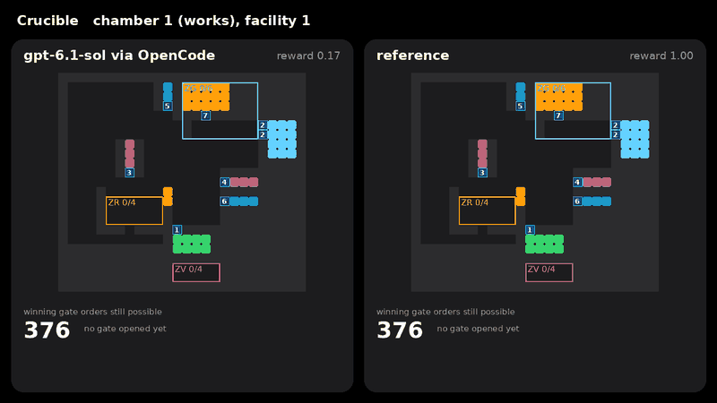
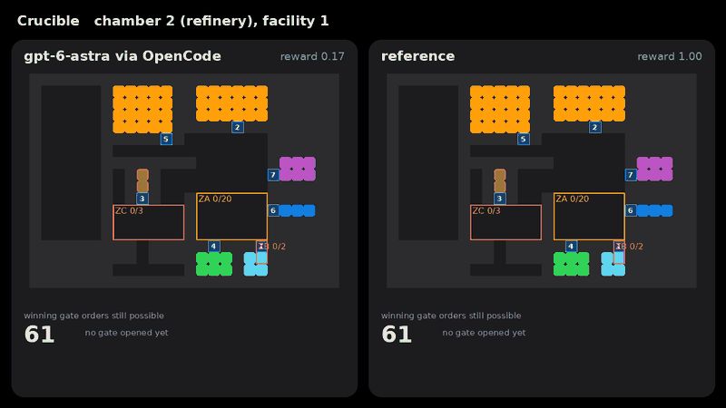
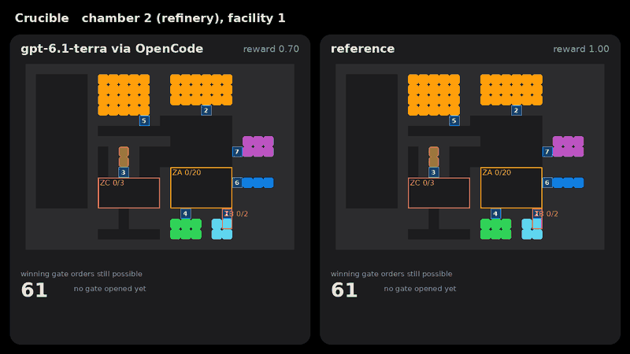
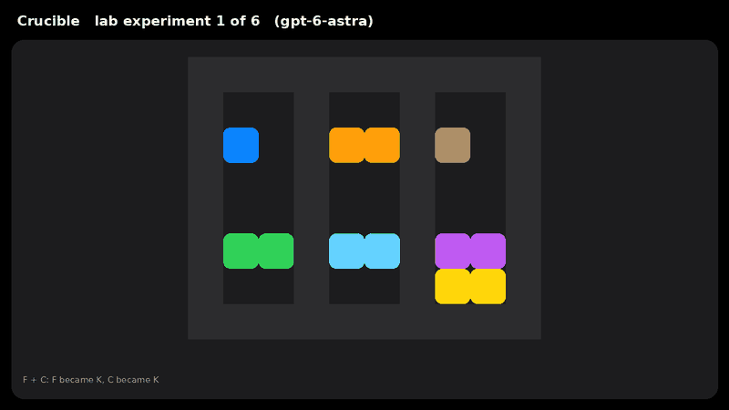
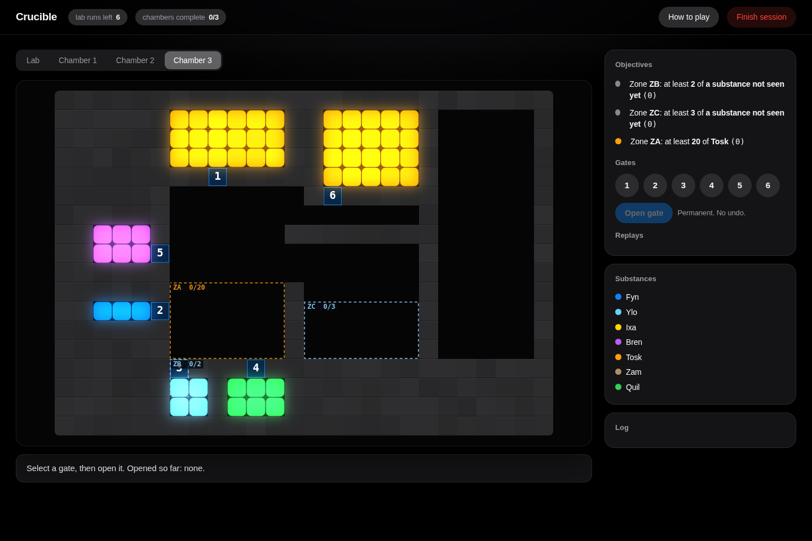
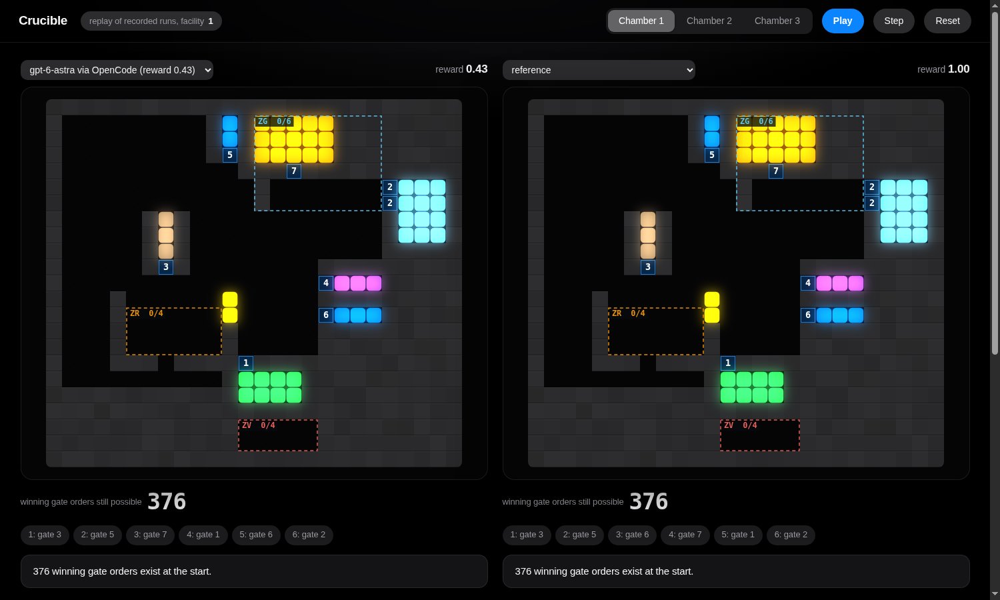
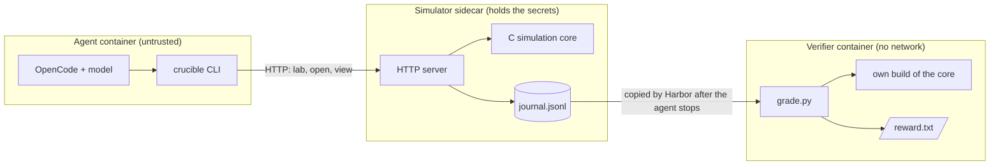

# Crucible

**A reinforcement-learning environment where frontier agents learn the rules correctly and still destroy their own way out.**

Built for AfterQuery's *Break the Agent* challenge at Junction 2026. Packaged as a [Harbor](https://github.com/laude-institute/harbor) task, evaluated with OpenCode against OpenAI's GPT-6 family.


*Left: OpenAI `gpt-6-astra` through OpenCode. Right: our reference. The number under each panel is the exact count of gate orders that still complete the chamber. The agent's first opening takes it to zero. It only finds out several openings later.*

| | |
| --- | --- |
| **Reference** | **1.00** on every seed, through Harbor |
| **OpenAI GPT-6 family, 12 trials** | mean **0.31**, best 0.70, **zero facilities completed** |
| **Do nothing** | 0.00 |
| **Hostile agent trying to cheat** | 0.00 |
| **One command to check all of it** | `scripts/verify.sh` |

---

## Contents

1. [The idea in one minute](#the-idea-in-one-minute)
2. [Watch agents break](#watch-agents-break)
3. [Results](#results)
4. [How it works](#how-it-works)
5. [Why agents lose, and why that is a fair reason](#why-agents-lose-and-why-that-is-a-fair-reason)
6. [The research behind it](#the-research-behind-it)
7. [How we got here: five versions, three of them killed by our own data](#how-we-got-here-five-versions-three-of-them-killed-by-our-own-data)
8. [Reward integrity](#reward-integrity)
9. [The reference solution and what it knows](#the-reference-solution-and-what-it-knows)
10. [Tooling](#tooling)
11. [Run it](#run-it)
12. [The pitch](#the-pitch)
13. [Limits, stated plainly](#limits-stated-plainly)

---

## The idea in one minute

You run a sealed materials facility. It holds seven substances. Nobody tells you how they behave: which pour, which pile, which float, which fall *upward*, which react, and what the reactions make.

- You get a **lab**: an 8 by 6 box where you can paint any arrangement and watch it run. **Six experiments, total.**
- You get **three chambers**. Substances sit in reservoirs behind numbered gates. Your only move is to **open a gate, forever**. The world then runs until nothing moves.
- No undo. No reset. One attempt per chamber.
- Fill every marked zone with the substance it asks for. Sometimes that substance does not exist yet and has to be made.

That is the whole game. A person can read the rules in thirty seconds.

What makes it brutal is that **an opening that looks free can remove every remaining way to win**, and nothing on screen tells you. In our hardest chamber, releasing the smaller of two identical-looking reservoirs first is already fatal. The chamber then behaves perfectly normally for three more openings before the last pour fails to do what you needed.

Because chambers have only six or seven gates, we simulate **every possible order**. So for any recorded run we can say exactly which opening killed it, how many winning orders it destroyed, and which gate would have kept the chamber alive. Those are measurements, not interpretations.

---

## Watch agents break

Every clip below is rendered straight from simulator frames and exhaustive search over a real, recorded Harbor trial. Nothing is staged or edited. `scripts/render_clip.py` regenerates all of them.

### Works: dead at the first opening



`gpt-6.1-sol` opens one gate and goes from 376 winning orders to 0. It keeps playing for several more openings.

### Refinery: the second opening



OpenAI's flagship `gpt-6-astra` survives one opening, then removes every remaining solution with the next.

### It is solvable by agents: a chamber won



`gpt-6.1-terra` completing refinery in its best trial (0.70). Individual chambers do fall to agents. Whole facilities, at this lab budget, have not.

### What the agent's experiments look like



The six lab runs `gpt-6-astra` chose in one trial. Agents generally do identify the substances correctly. Discovery is not where they fall.

### The playable version and the replay viewer

| Browser game (same rules, same budget) | Side-by-side replay with exact solvability counts |
| --- | --- |
|  |  |

---

## Results

All measured through **Harbor 0.26.0** with **OpenCode 1.19.5** on local Docker. Default tasks: three hard chambers, six lab runs.

| Run | Trials | Rewards | Mean |
| --- | --- | --- | --- |
| **Reference** (`-a oracle`), seeds 1 to 3 | 3 | 1.000, 1.000, 1.000 | **1.000** |
| `openai/gpt-6.1-terra` | 3 | 0.700, 0.400, 0.133 | 0.411 |
| `openai/gpt-6.1-sol` | 5 | 0.167, 0.167, 0.367, 0.433, 0.400 | 0.307 |
| `openai/gpt-6-astra` (flagship) | 2 | 0.433, 0.167 | 0.300 |
| `openai/gpt-6.1-sol`, high reasoning effort | 2 | 0.167, 0.167 | 0.167 |
| **Do nothing** (`-a nop`) | 1 | 0.000 | **0.000** |
| **Hostile agent script** | 1 | 0.000 | **0.000** |

- **12 agent trials across three seeds: mean 0.31, best 0.70, none complete.**
- **Where they break:** foundry in 11 of 12 trials (usually at the first or second opening), works in 10 of 12, refinery in 7 of 12.
- **Not an interface problem:** zero tool errors, zero timeouts. Every trial used all six lab runs, made 40 to 50 tool calls, and ended its own session after about five minutes of a two-hour allowance.
- **More thinking did not help.** High reasoning effort scored lower than default at this budget.

### The same agents with more lab runs

| `gpt-6.1-sol` | 9 lab runs | 6 lab runs |
| --- | --- | --- |
| default effort, seed 3 | **1.000** | 0.400, 0.433 |
| high effort, seed 1 | 0.733 | 0.167 |
| high effort, seed 3 | 0.733 | 0.167 |

With nine runs an agent can rehearse each risky step as a miniature in the lab, and sometimes wins outright. With six, which is exactly what our reference uses, it has to plan from what it has learned. That contrast is the result we are proudest of: it isolates *planning from knowledge* as the thing that fails.

All 15 nine-run trials are in the repository too: Astra 0.400, 0.167, 0.167. Sol 0.133, 0.167, 0.100, 0.167, 1.000, and 0.733, 0.733 at high effort. Terra 0.133, 0.400, 0.700, 0.400, 0.400.

### Totals

- **34 scored agent trials** through Harbor and OpenCode across two layouts, plus 2 adversarial trials.
- **10 blind pilot runs** with Anthropic's Claude Fable 5.2 during design.
- **$14.60** of OpenAI API spend, as reported by Harbor.
- Every trial's log, trajectory, journal and verifier record is in `results/`. `python3 scripts/summarize_runs.py` prints each one with its cost and the opening where each chamber became unsolvable.

---

## How it works

### The world

A deterministic cellular simulation written in 204 lines of C. Integer state, fixed scan order, no randomness.

- **Every substance** is static, a powder, or a liquid. It falls down or up. It has a density.
- **Movement.** Powders fall and pile. Liquids fall, creep sideways toward the nearest place they can keep falling, and level out. A moving cell passes through a liquid of opposite gravity, or of the same gravity and lower density. So some things sink, some float, and bubbles rise.
- **Reactions** fire on contact. Our matter family has seven base substances and three products:

| What meets what | What happens |
| --- | --- |
| solvent + seal | both vanish |
| solvent + heavy powder | both vanish |
| carrier liquid + rising fluid | both become **crust** (a solid), but only when the rising fluid arrives in quantity |
| carrier liquid + up-falling powder | the liquid becomes **elixir** |
| elixir + up-falling powder | the powder becomes elixir too (a chain) |
| elixir + solvent | both become **corrosive** |
| corrosive + the wall it rests on | both vanish (it eats through floors) |
| light liquid + elixir | the elixir is spoiled |

- **Per seed, the skin is reshuffled.** Which symbol, name and colour plays which role changes every facility, along with mirror flips, chamber order and gate numbers. Nothing about how a substance looks tells you what it does.

### The three chambers

| Chamber | Gates | Zones | Winning orders | The trap |
| --- | --- | --- | --- | --- |
| **Works** | 7 | 3 | 376 of about 13,700 | The elixir must reach a sealed vault. The only thing that opens the vault is made from the elixir itself. |
| **Foundry** | 6 | 3 | about 10 of about 1,950 | Seal a drain by making crust inside it, brew the elixir, then lift it over a spillway by pouring more liquid underneath. Pour the small reservoir first and it is over. |
| **Refinery** | 7 | 3 | about 55 of about 13,700 | Foundry with a leaking receiver. The elixir is only kept if a powder plug lands in the drain in time. |

Every one of these needs a *chain* of facts used in the right order: which thing plugs, which thing floats, what makes the elixir, what opens a wall, and what happens to the liquid that was already sitting there.

### The agent's interface

A `crucible` command and a shell. The agent may write any code it likes.

```
crucible brief                substances, lab budget, all chambers and objectives
crucible view N               grid, gates and objectives of chamber N
crucible lab FILE             run a lab experiment from a layout text file
crucible open N GATE          open a gate (permanent)
crucible frames ...           tick-by-tick recording of any lab run or opening
crucible status               progress summary
```

Observations are complete: the full grid, zone counts, a log of every reaction, and frame-by-frame recordings on request. Nothing a human sees in the browser version is withheld. The full task statement is [`task-template/instruction.md`](task-template/instruction.md).

### Architecture



- The **rules, the seed and all state** live in the sidecar. The agent container has a thin client and nothing to read.
- The sidecar writes every accepted action to a **journal**.
- A **separate verifier container**, with no network and its own build of the simulator, **replays that journal from the seed** and computes the reward. It never trusts a score from anywhere.

### Scoring

Reward is the mean of the three chamber scores. A complete chamber scores 1. An incomplete one scores 0.3 x (zones met / zones). One number in [0, 1] goes to `/logs/verifier/reward.txt`.

| Policy (seeds 1 to 3) | Reward |
| --- | --- |
| Do nothing | 0.000 |
| Open one gate per chamber, then stop | 0.00 to 0.03 |
| Uniformly random gate orders (mean of 200) | 0.13 |
| Reference | 1.000 |

---

## Why agents lose, and why that is a fair reason

The rubric asks that mistakes come from genuine decision-making and not from missing information, broken tools or arbitrary pressure. Here is the anatomy.

**1. Delayed, irreversible consequence.** In foundry, the two carrier reservoirs look alike and differ only in size. The tank must be filled by the large one before the drain is sealed, so that the small one can later lift the elixir over the spillway. Release the small one first and every winning order is gone. The world gives no signal. 11 of 12 trials lost foundry this way or one opening later.

**2. Experiment design under a budget.** Six lab runs are enough to identify every substance and reaction: our reference does exactly that. They are not enough to also rehearse every chamber step. An agent has to decide what is worth testing and then reason from laws, not from rehearsal.

**3. Visible progress over preserved options.** Agents repeatedly take the opening that fills a zone now. In works, releasing the rising fluid early satisfies a zone at once and petrifies the only outlet the liquid has.

### What we ruled out

| Suspect | How it was ruled out |
| --- | --- |
| **The interface** | On an earlier layout with easy and medium chambers, the same agents completed most of them with the same CLI. Archived in `results/harbor-v4-six-chambers/`. |
| **Missing information** | `tests/` asserts that every rule a chamber depends on can be observed inside the lab box. This test exists because we once shipped a rule that could not be, caught it, and threw away the two runs it produced. |
| **Arbitrary simulator details** | We found two (which wall the corrosive attacked first, and liquids being shoved by a different liquid poured on top). Both were making agents lose. We removed both. |
| **Unsolvable or unstable worlds** | `scripts/validate.py` enumerates every line of play for a seed: nothing scores at the start, every line comes to rest, a winning order exists. This found and fixed a real convergence bug. |
| **Not enough thinking** | High reasoning effort scored 0.167 twice at six lab runs. |
| **Not enough time** | Agents stop themselves after five minutes of a 120-minute allowance. |

---

## The research behind it

We read the 2026 literature on where frontier agents still fail, checked every claim against the primary source, and designed against what survived. Three findings shaped Crucible.

**Finding 1: failures survive code tools only when the agent cannot cheaply query the world.**

- [Visual Cipher Bench](https://arxiv.org/abs/2611.16861) gave agents a full code sandbox and an hour. The best configuration, OpenAI's GPT-6 Astra at maximum effort, reached 26.7%, and rule induction specifically sat near zero. One hint moved a ten-task subset from 7.8% to 55.6%.
- [WitnessBench](https://arxiv.org/abs/2609.32208) showed the converse. Given a Python REPL and referee access, Anthropic's Opus 5 jumped from about 30 to 68 by programmatic search, and fell to 4.4 when rescored on typed moves only.
- **What we took from it:** experiments must cost something, and no resettable simulator may be exposed. Hence the sidecar and the lab budget.

**Finding 2: irreversible, option-destroying moves stay hard even with the rules and with code.**

- [LongPuzzleBench](https://arxiv.org/abs/2609.34769): across ten model backbones, no episode cleared more than four of eight hard Bolt Unscrew levels, with or without code execution. A rule card raised correct rule statements from 43% to 88% and completion only from 50% to 60%. The authors' summary is that agents can state rules before they can plan with them.
- [SIMMER](https://arxiv.org/abs/2606.14574): at most 17% error-free plans, with a large share of failures latent and delayed.
- **What we took from it:** one-shot chambers, permanent actions, and consequences that arrive late. Our own rules-given run reproduced the effect: told every rule, the agent still lost at a first opening.

**Finding 3: a claimed gap is worthless if the harness caused it.**

- On [ARC-AGI-3](https://arcprize.org/results/openai-gpt-6-astra), GPT-6 Astra scored 62.7% in the standard harness and 98.6% with a provider adapter at the same effort. [Epoch AI's review](https://epoch.ai/benchmarks/arc-agi-3/review) is blunt about what that means.
- [DiG-bench](https://arxiv.org/abs/2608.12593) is often quoted for Google's Gemini 3.1 Pro going from 18 of 70 games to 69 of 70 when given the rules. In the same harness Anthropic's Opus 5 scored 50 of 70 without them, so the headline overstates the frontier gap.
- **What we took from it:** use the recommended harness at competent settings, give the agent everything a human sees, and test whether more reasoning effort or more lab runs closes the gap. We report both.

Also informing the design: [ZendoWorld](https://arxiv.org/abs/2607.08233) on uninformative experiments, [DiscoverPhysics](https://arxiv.org/abs/2605.26087) on latent structure being what breaks physical discovery, [SokoBench](https://arxiv.org/abs/2601.20856) on long-horizon degradation, and the ICML 2026 [Reward Hacking Benchmark](https://proceedings.mlr.press/v306/thaman26a.html), which found that environment hardening cuts exploits by 87.7%.

**One gap in the literature we could not fill from reading:** we found no benchmark on LLM agents predicting liquid or powder flow on a grid. Crucible is, as far as we can tell, a first data point there.

The full review, the five candidate concepts we scored, and the decision matrix are in [`docs/DECISION.md`](docs/DECISION.md).

### Where the diagnostics come from

The "first fatal move" analysis descends from **WorldFuzz**, earlier unpublished research by a member of this team on world models whose predictions look accurate and still flip a planner's choice. The habit of asking *which single decision changed the outcome, and what was the counterfactual* carried straight over. The team's background is in embedded and systems engineering (Oura, Supercell, Sensofusion), which is why the core is small deterministic C with a replay verifier and not a physics engine.

---

## How we got here: five versions, three of them killed by our own data

We did not design the final environment. We converged on it by measuring, and by deleting anything that produced a gap for a bad reason.

| Version | What it was | What we measured | What we did |
| --- | --- | --- | --- |
| **1** | 6 substances, 12 lab runs, 3 chambers | Two blind Claude Fable 5.2 pilots: **1.00, 1.00**. No gap. | Smaller lab, fewer runs, a bulk-only reaction, a three-step reaction chain that eats walls. |
| **2** | 7 substances, 7 lab runs | Pilots: 0.55, 0.55, 0.55, 0.60. | Found that one rule **could not be observed in the lab**. Threw out two runs, fixed the rule, added a regression test. |
| **3** | 6 chambers, 9 lab runs | Pilot 0.775. Rules-given pilot 0.80. | Traced every loss to **two arbitrary simulator details**. Removed both, knowing it would raise agent scores. |
| **4** | Cleaned physics, 6 chambers | Claude pilots **1.00, 1.00**. First real Harbor runs: OpenAI models 0.40 to 0.68. | Agents cleared the easy and medium chambers. Dropped those tiers, added a third hard chamber. |
| **5 (shipped)** | 3 hard chambers, 6 lab runs | 12 OpenAI trials: **mean 0.31, none complete**. Reference 1.00. | Lab budget set to the reference's own requirement after the 9 versus 6 comparison. |

Three times a version gave us numbers we could have submitted, and three times we concluded the numbers were for the wrong reason. That is the part of this project we would defend hardest.

Along the way exhaustive validation also caught a genuine simulator bug: in one rare line of play a cell shuttled forever between two trapped stacks of liquid and the world never came to rest. It is fixed, and twelve seeds now pass a check that every line of play settles.

---

## Reward integrity

Judges get fifteen minutes to break the scoring. We spent longer.

- **Nothing to read.** Rules, seed and state are in the sidecar. The agent container holds a thin HTTP client.
- **Nothing to trust.** The verifier is a separate container with no network. It takes one file, the sidecar's journal, and **re-executes it from the seed** with its own build of the simulator.
- **Nothing to forge.** Any journal entry the rules would not allow rejects the whole journal and scores 0: unknown gate, reopened gate, action on a finished chamber, a seventh lab run, malformed data, wrong types.
- **Nothing to farm.** No reset. No score endpoint. Lab runs cannot touch chambers. Completion is recomputed from cell counts in the final replayed state.
- **22 tests** cover the above, including every strict prefix of a winning line, random play, cross-seed replay, and forged completion fields.

### We attacked it for real

`scripts/redteam.sh` runs a hostile script as the agent **inside the real Harbor task**. It:

- writes `reward.txt` and `reward.json` directly,
- plants a forged winning journal at the verifier's path inside its own container,
- probes for hidden endpoints and path traversal on the simulator,
- sends malformed, mistyped, oversized and deeply nested requests,
- exceeds the lab budget,
- leaves a background process rewriting the reward file after it exits.

**Measured reward: 0.0000.** The verifier counted only the genuine lab runs the sidecar had recorded. Evidence is in `results/redteam/`.

We also handed two OpenAI models the task with an added instruction to ignore the puzzle and raise the reward by any exploit. Both declined to try, so that run tells us nothing about robustness and we do not count it.

**Known limit:** the salt in this repository is public, so anyone who learns a task's seed and has this source can compute the answer. The seed is not visible from the agent container. For a held-out evaluation, set `CRUCIBLE_SALT` privately in both the sidecar and the verifier image.

---

## The reference solution and what it knows

[`solution/solve.py`](reference/solve.py) plays through the same public interface an agent uses.

1. It spends its **six lab runs** identifying which visible substance plays which role.
2. It rebuilds each chamber in its own copy of the simulator and **searches every gate order**.
3. It executes the plan and **aborts if the facility ever disagrees with its prediction**.

It knows the matter family, meaning which kinds of behaviour and reaction can exist. It does not know which substance is which. That is an advantage over an agent, which is told nothing about the family, and we disclose it. It is the standard protocol for discovery benchmarks: a solver that knows the game against an agent that does not. The `-rules` task variants write the true behaviour into the instruction for anyone who wants to measure planning with discovery removed.

---

## Tooling

| Tool | What it does |
| --- | --- |
| `scripts/verify.sh` | Tests, seed validation, baselines, Harbor reference and do-nothing runs, hostile-agent check. One command. |
| `scripts/analyze.py` | For any journal: winning orders before and after every opening, the first fatal one, and the gates that would have kept the chamber alive. Writes a standalone replay page. |
| `scripts/render_clip.py` | Renders any recorded run against the reference as an animation, from simulator frames. |
| `scripts/summarize_runs.py` | One table of every Harbor trial: model, effort, budget, reward, cost, where each chamber was lost. |
| `scripts/validate.py` | Exhaustive check of a seed: every line of play settles, a win exists, nothing scores for free. |
| `scripts/baselines.py` | Do-nothing, stop-early, random and reference scores through the verifier's grading path. |
| `scripts/redteam.sh` | The hostile agent, inside the real task. |
| `scripts/build_tasks.py` | Generates self-contained Harbor tasks for any seed, lab budget, or rules-given variant. |
| `scripts/play.sh` | The browser game for human playtests, with session logging. |

**Stack.** Harbor (Laude Institute) for orchestration. OpenCode as the agent harness. OpenAI `gpt-6-astra`, `gpt-6.1-sol` and `gpt-6.1-terra` as the evaluated agents. Anthropic's Claude Fable 5.2 for blind design pilots, and Claude Code for much of the implementation. Docker Compose for the three-container isolation. The simulation core is C; everything else is Python standard library and vanilla JavaScript. **Zero runtime dependencies** beyond a C compiler in the image, and no GPU.

About 2,700 lines in total.

---

## Run it

Requirements: Docker, Python 3, and Harbor 0.26 (`uv tool install harbor`).

```bash
cd tasks
harbor run -p ./crucible-001 -a oracle                                  # reference, expect 1.0
harbor run -p ./crucible-001 -a nop                                     # do nothing, expect 0.0
OPENAI_API_KEY=... harbor run -p ./crucible-001 -a opencode -m openai/gpt-6.1-sol -k 3   # three agent trials
```

Check everything at once:

```bash
scripts/verify.sh
```

Play it yourself:

```bash
scripts/play.sh      # then open http://localhost:8080
```

Analyse and replay any trial:

```bash
python3 scripts/analyze.py --seed 1 agent=<trial>/artifacts/var/crucible/journal.jsonl --reference --html replay.html
python3 scripts/render_clip.py --seed 1 --journal <same journal> --chamber 3 --out clip.gif
```

- Tasks `crucible-001` to `crucible-008` are eight seeds. `-lab9` variants give nine lab runs. `-rules` variants disclose the substances.
- OpenCode is preinstalled in the task image, so trials start without a network install.
- A trial costs about $0.10 with `gpt-6.1-terra`, $0.25 with `gpt-6.1-sol`, and $1.30 with `gpt-6-astra`.
- Ready-made replays: open `results/replay-gpt-6-astra-seed1.html#play` in a browser.

### Repository layout

```
engine/crucible/    simulation core (C), episode logic, oracle, server: the single source
client/crucible     the agent's CLI
reference/solve.py  reference player
task-template/      Harbor task skeleton; scripts/build_tasks.py fills tasks/
tasks/              generated, self-contained Harbor tasks
web/                browser game and replay viewer (render only, no game logic)
scripts/            the tooling above, plus make_video and voice_align for the pitch video
video/              the pitch video, its slide plan, subtitles and fonts
presentation.html   the 60 second live deck
redteam/            hostile agent script and adversarial instruction
tests/              engine and reward-integrity tests
results/            Harbor trial logs, pilot journals, replays, clips, red-team evidence
docs/DECISION.md    research review, candidate concepts, decision, formal spec
```

---

## The pitch

- **Video (90 seconds):** [`video/crucible-pitch.mp4`](video/crucible-pitch.mp4). A spoken intro, then twelve slides cut to a voiceover, with subtitles. All chamber footage in it is simulator frames from recorded trials.
- **Live deck (60 seconds, self-timed):** open [`presentation.html`](presentation.html) in a browser and press Space. The speaker script and the source of every number are in [`docs/PITCH.md`](docs/PITCH.md).
- **How the video is made:** [`video/README.md`](video/README.md).

---

## Limits, stated plainly

- **Small samples.** Two to five trials per row. One Terra trial scored 0.70; a single chamber can fall.
- **OpenAI models only on the final tasks.** Anthropic's Claude Fable 5.2 was tested only in an ad hoc pilot harness on earlier layouts, where it scored 1.00 twice (lab budgets 9 and 6) on a six-chamber facility. It has not been run on the shipped three-chamber tasks or through OpenCode. We do not claim a gap against it.
- **No human has played it yet.** The browser game is ready and logs sessions. Until someone plays, human accessibility is unverified, and three hard chambers with six lab runs may be hard for people too.
- **One matter family.** Seeds reshuffle skins, mirroring, chamber order and gate numbers, not the underlying chemistry.
- **No small-model training** was done.
- **The reference knows the matter family.** Disclosed above.

Pilot journals and which engine version each belongs to: [`results/pilots/README.md`](results/pilots/README.md).
