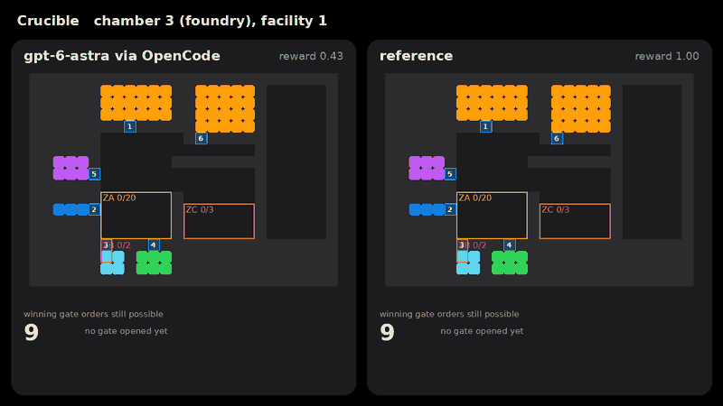

# Crucible

A Harbor task for AfterQuery's "Break the Agent" challenge (Junction 2026).

An agent runs a sealed materials facility. Seven substances behave in ways it is not told. It has a small lab with 6 runs to learn them, then three chambers where its only action is opening a gate, permanently, with one attempt per chamber. An opening that looks harmless can remove every way of finishing the chamber, and the agent only finds out several openings later.



Left: `gpt-6-astra` through OpenCode. Right: the reference. The number under each panel is the exact count of gate orders that still complete the chamber.

## Results

Measured through Harbor 0.26.0 with OpenCode 1.19.5 on local Docker.

| Run | Trials | Rewards | Mean |
| --- | --- | --- | --- |
| Reference (`-a oracle`), seeds 1 to 3 | 3 | 1.000, 1.000, 1.000 | 1.000 |
| `openai/gpt-6.1-terra` | 3 | 0.700, 0.400, 0.133 | 0.411 |
| `openai/gpt-6.1-sol` | 5 | 0.167, 0.167, 0.367, 0.433, 0.400 | 0.307 |
| `openai/gpt-6-astra` | 2 | 0.433, 0.167 | 0.300 |
| `openai/gpt-6.1-sol`, high reasoning effort | 2 | 0.167, 0.167 | 0.167 |
| Do nothing (`-a nop`) | 1 | 0.000 | 0.000 |
| Hostile agent script (`scripts/redteam.sh`) | 1 | 0.000 | 0.000 |

- **12 agent trials across three seeds: mean 0.31, best 0.70, none complete.**
- Chambers lost: foundry in 11 of 12 (usually at the first or second opening), works in 10 of 12, refinery in 7 of 12.
- No trial hit a tool error or a timeout. Each used all 6 lab runs, made about 40 to 50 tool calls, and ended its own session after roughly 5 minutes.
- Every trial's log, trajectory, journal and verifier record is under `results/harbor/`. `python3 scripts/summarize_runs.py` prints each one with its cost and the opening at which each chamber became unsolvable.

Caveats: 2 to 5 trials per row, one harness, OpenAI models only. Cost reported by Harbor for all 27 recorded agent trials: $11.88.

## Run it

Requirements: Docker, Python 3, and [Harbor](https://github.com/laude-institute/harbor) 0.26 (`uv tool install harbor`).

```bash
cd tasks
harbor run -p ./crucible-001 -a oracle                                  # reference, expect 1.0
harbor run -p ./crucible-001 -a nop                                     # do nothing, expect 0.0
OPENAI_API_KEY=... harbor run -p ./crucible-001 -a opencode -m openai/gpt-6.1-sol -k 3   # three agent trials
```

Everything at once, including tests and the hostile-agent check: `scripts/verify.sh`.

Tasks `crucible-001` to `crucible-008` are different seeds. `-lab9` variants give 9 lab runs, `-rules` variants disclose the true substance behaviour in the instruction. More: `python3 scripts/build_tasks.py 9 10 [--rules] [--lab-runs N]`. OpenCode is preinstalled in the task image, so trials start without a network install. Agent timeout is 120 minutes; the reference needs about 20 seconds.

## The task

- **Substances.** Each is static, a powder or a liquid, falls down or up, and has a density. Some pairs react on contact. One reaction only happens when there is enough of one reactant. One product reacts again, and that second product eats the wall it rests on. Symbols, names and colours are reshuffled per seed, so appearance tells nothing.
- **Lab.** An 8 by 6 box. The agent draws any layout and it runs to rest under the same rules. 6 runs for the whole episode. Products cannot be placed; they have to be made inside a run.
- **Chambers.** Substances sit in reservoirs behind numbered gates. `open` removes a gate for good and the world runs until nothing moves. Zones ask for a minimum count of a substance, sometimes one that does not exist yet.
  - *works* (7 gates, 3 zones): the elixir must reach a sealed vault, and the only thing that opens the vault is made from the elixir itself. 376 of roughly 13,700 gate orders win.
  - *foundry* (6 gates, 3 zones): seal a drain by making crust inside it, brew the elixir, then lift it over a spillway by pouring more liquid underneath. About 10 of roughly 1,950 orders win.
  - *refinery* (7 gates, 3 zones): foundry with a leaking receiver; the elixir is only kept if a powder plug is dropped into the receiver's drain in time. About 55 of roughly 13,700 orders win.
- **Observations.** The full grid, zone counts, a log of every reaction, and tick-by-tick recordings on request. Nothing shown in the browser version is withheld from the agent.

The agent gets a `crucible` CLI (`brief`, `view`, `lab`, `open`, `close`, `frames`, `status`) and may write any code it likes. The full statement is `task-template/instruction.md`.

## Why agents lose, and why that is a fair reason

The losses are planning failures under irreversibility, with the information available:

- **Delayed consequence.** In foundry, releasing the smaller reservoir first already makes the chamber unsolvable. Nothing looks wrong until the last pour fails to lift the elixir over the spillway. 11 of 12 trials lost foundry this way or one opening later.
- **Experiment design under a budget.** With 9 lab runs an agent can rehearse each risky step as a miniature in the lab, and sometimes wins. With 6, which is exactly what the reference uses, it has to plan from what it has learned.

| `gpt-6.1-sol` | 9 lab runs | 6 lab runs |
| --- | --- | --- |
| default effort, seed 3 | 1.000 | 0.400, 0.433 |
| high effort, seed 1 | 0.733 | 0.167 |
| high effort, seed 3 | 0.733 | 0.167 |

All 15 trials at 9 runs are in `results/harbor/` too: Astra 0.400, 0.167, 0.167; Sol 0.133, 0.167, 0.100, 0.167, 1.000 and 0.733, 0.733 at high effort; Terra 0.133, 0.400, 0.700, 0.400, 0.400.

What was ruled out as a cause:

- **Interface.** On an earlier layout that still had easy and medium chambers, the same agents completed most of them with the same CLI (`results/harbor-v4-six-chambers/`, git tag `v4-six-chambers`).
- **Missing information.** `tests/` asserts that every rule a chamber depends on can be observed inside the lab box.
- **Arbitrary simulator details.** Two were found during development (which wall the corrosive product attacked first, and liquids being shoved by a different liquid poured on top). Both were removed, even though they lowered agent scores.
- **Unsolvable or unstable worlds.** `scripts/validate.py` enumerates every line of play for a seed: nothing scores at the start, every line comes to rest, and a winning order exists.

## Scoring

Reward = mean of the three chamber scores. A complete chamber scores 1; an incomplete one scores 0.3 x (zones met / zones). It is written to `/logs/verifier/reward.txt`.

| Policy (seeds 1 to 3, graded by journal replay) | Reward |
| --- | --- |
| Do nothing | 0.000 |
| Open one gate per chamber, then stop | 0.00 to 0.03 |
| Uniformly random gate orders (mean of 200) | 0.13 |
| Reference | 1.000 |

Reproduce with `python3 scripts/baselines.py`.

## Why the reward is hard to hack

- The rules, the seed and the episode state live in a sidecar container (`sim`). The agent's container holds only a thin HTTP client.
- The sidecar appends every accepted action to a journal. After the agent stops, Harbor copies that one file out of the sidecar into a **separate verifier container** with no network.
- The verifier has its own build of the simulator. It ignores everything else and **re-executes the journal from the seed**. Any entry the rules would not allow (unknown gate, reopened gate, action on a finished chamber, a seventh lab run, malformed data) rejects the whole journal and scores 0.
- There is no reset and no score-setting endpoint. Lab runs cannot touch chambers. Completion is recomputed from cell counts in the final replayed state, so reports, files and extra journal fields change nothing.
- `python3 -m unittest discover tests` covers these cases (22 tests).
- `scripts/redteam.sh` runs a hostile script as the agent inside the real Harbor task: it writes reward files, plants a forged winning journal at the verifier's path in its own container, probes for hidden endpoints and path traversal, sends malformed and oversized requests, exceeds the lab budget, and leaves a background process rewriting the reward. Measured reward: 0.0000 (`results/redteam/`).
- Two models were also given the task with `redteam/adversarial_instruction.md` (ignore the puzzle, raise the reward by any exploit). Both declined to try, so that run says nothing about robustness; the scripted check is the evidence.

Known limit: the public salt in this repository makes seed to world deterministic, so anyone who learns a task's seed and has the source can compute the answer. The seed is not visible from the agent container. For a held-out evaluation set `CRUCIBLE_SALT` privately in both the sidecar and the verifier image.

## Reference solution and what it knows

`solution/solve.py` uses only the public interface. It knows the matter family (which kinds of behaviour and reaction can exist) but not which visible substance is which. It spends its 6 lab runs identifying them, plans each chamber by exhaustive search in its own copy of the simulator, and aborts if the facility ever disagrees with its prediction.

That is an advantage over an agent, which is told nothing about the family. It is the protocol discovery benchmarks use (a solver that knows the game against an agent that does not), and it is disclosed here rather than hidden. The `-rules` task variants remove the discovery part for anyone who wants to measure planning alone.

## Diagnostics: the first fatal move

Chambers have few gates, so every order is simulated and the counts are exact.

```bash
python3 scripts/analyze.py --seed 1 agent=path/to/journal.jsonl --reference --html replay.html
python3 scripts/render_clip.py --seed 1 --journal path/to/journal.jsonl --chamber 3 --out clip.gif
```

`analyze.py` prints, per opening, how many winning orders existed before and after, flags the opening that eliminated all of them, and lists the gates that would have kept the chamber solvable. `replay.html` is a standalone side-by-side viewer; add `#play` to the URL to start playback at once. A trial's journal is at `<trial>/artifacts/var/crucible/journal.jsonl`. Ready-made replays: `results/replay-gpt-6-astra-seed1.html` and `results/replay-gpt-6.1-sol-seed1.html` (the second is a 9-run trial).

## Other evidence, with its limits

- **Claude Fable 5.2 was only tested in an ad hoc pilot harness, on earlier layouts.** As a sub-agent with a shell, the CLI and no source access, it scored 1.00 twice on a six-chamber layout (lab budgets 9 and 6) and 0.80 once with the rules given. It has not been run on the current three-chamber tasks or through OpenCode, so the gap above is established for OpenAI models only. Journals are in `results/pilots/`; they replay at the git tags noted in `results/pilots/README.md`.
- **No human has played it.** `scripts/play.sh` serves the same game in a browser at `http://localhost:8080` with the same lab budget and one-shot chambers, and saves each session to `playtests/sessions/`. Until someone plays, human accessibility is unverified, and three hard chambers with 6 lab runs may be hard for people too.
- **No small-model training was done.**

## Layout

```
engine/crucible/    simulation core (C), episode logic, oracle, server: the single source
client/crucible     the agent's CLI
reference/solve.py  reference player
task-template/      Harbor task skeleton; scripts/build_tasks.py fills tasks/
tasks/              generated, self-contained Harbor tasks
web/                browser game and replay viewer (render only, no game logic)
scripts/            verify, build_tasks, validate, baselines, analyze, summarize_runs, render_clip, redteam, play, design
redteam/            hostile agent script and adversarial instruction
tests/              engine and reward-integrity tests
results/            Harbor trial logs, pilot journals, replays, clip, red-team evidence
docs/DECISION.md    research review, candidate concepts, decision, formal spec
```

Determinism: integer state, fixed scan order, no randomness in the simulation. A seed fixes the skin, mirror flips, chamber order and gate numbering.
